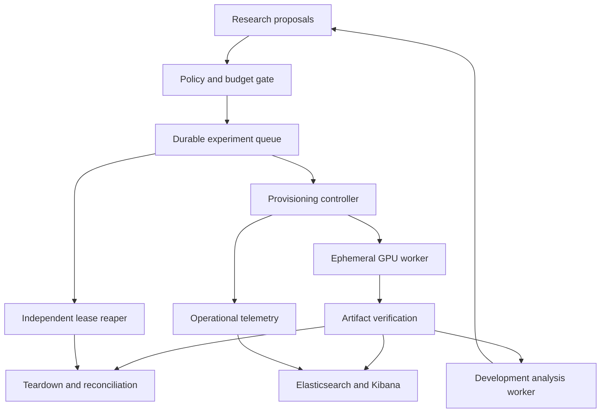

# Bounded experiments, feedback and observability

## Control plane and workers

Keep the durable coordinator, database, credential broker, artifact store and analysis workers outside disposable GPU instances. Kubernetes runs these control services on the local lab or approved cloud cluster. Vast.ai supplies short-lived worker capacity through a provider adapter. The GPU container receives a signed experiment specification, pinned image, approved code/data digests and short-lived artifact access. It receives no banking credentials, Stripe secret, unrestricted vault access or unrestricted cloud-control key.

Recommended ownership: The Swarm owns queues, retries and leases; Mathematical Governance owns evidence/stopping policies; Credential Manager owns scoped provider access; F Secure owns workload and network controls; this repository owns mathematical code, experiment specifications and results contracts. SQL is the source of truth for job/payment state; object storage holds durable artifacts; Elasticsearch is a searchable projection. Kibana is an analysis interface, not the authoritative ledger.

The final evaluator and holdout sit outside this feedback graph. The proposer can suggest changes; only the policy gate can dispatch an experiment. Account top-up does not automatically raise budgets or authorise trading.

## Provider decision

Use the documented Vast SDK/API lifecycle rather than assume an official Terraform provider exists. Terraform remains appropriate for stable control-plane resources when a supported provider is verified. A thin adapter behind a tested protocol avoids coupling the research model to a provisioning tool. [S18](SOURCES.md#s18)

Required adapter methods: quote/search, create with unique label, discover-by-label, inspect, execute with deadline, verify artifact acknowledgement, destroy, confirm destruction and reconcile billing. Pin and contract-test the selected SDK version before enabling the adapter. The reviewed SDK documents `create_instance`, returned `new_contract`, `show_instance`, data copying and destruction. No live SDK adapter is shipped in this checkpoint.

## Lease state machine

1. Register an immutable experiment specification: family/run IDs, parent result IDs, hypothesis, allowed code/container/data hashes, task type, seed, expected outputs, hardware limits and allowed egress.
2. Obtain a complete quote with currency, GPU time, storage, boot time and network charges. Reserve the worst-case allowance atomically. Missing price components or stale quotes block allocation. The reference lease accepts a supplied quote; it does not fetch or verify prices.
3. Persist ALLOCATING, unique label and expiry before calling create. On timeout, mark ALLOCATION_UNKNOWN and discover existing instances by label. Never blindly repeat create after an unknown outcome.
4. Record the instance ID; wait for readiness within the same total deadline. Failed/offline/unknown states and image-pull stalls end the run.
5. Run a bounded command. Export checkpoints and manifests during execution; verify digests at the durable store. A local file in the GPU container is not an exported result.
6. Destroy on success, error, timeout or cancellation. Verify absence/terminal destruction with the provider. A container exit or stopped VM may leave billable storage.
7. If destruction is uncertain, retain the reservation, mark CLEANUP_REQUIRED and alert the independent reconciler. Reconcile actual billed amounts and restore unused reserved budget only after evidence.

The SQLite reference tests successful and failed cleanup, unknown creation, duplicate IDs, restart persistence and zero-budget denial. It is a single-controller prototype, not a production security boundary. Caller-supplied policy values are trusted fixtures. Production requires authenticated grants and transactional multi-worker coordination.

A Python `finally` block cannot survive process/host death. The independent reaper polls provider inventory and durable leases from a separate failure domain; it handles orphaned IDs, expired labels, clock skew, provider outages and retries. Prefer a provider-enforced expiry where available, but do not claim one exists without verification. Enforce container runtime limits too. Runtime bounds reduce exposure; they cannot mathematically guarantee an external provider's final invoice during an outage.

Initial proposal: at most one concurrent GPU job, 300-second total lease including startup and export, no automatic retries after uncertain creation, and a hard cumulative authorised spending envelope. Actual amounts/currency await a verified quote and budget. CPU and small fixtures should filter out bad ideas before any rental. Prebuilt compact images reduce wasted startup time.

## Analysis worker and feedback controls

The shipped one-shot worker reads completed synthetic-development manifests, checks every artifact digest, compares models and writes hypotheses with parent run IDs. It cannot execute jobs, issue payments or consume final holdout data. This is a reproducible precursor to the requested daemon.

Production daemon: durable queue + idempotent job claim + verified manifest + bounded analysis task + schema-valid proposals + provenance links + transactional outbox. A fixed policy determines which low-cost development proposals may run autonomously inside an already authorised envelope. New task types, unseen data destinations, spend escalation and trading promotion require the appropriate authority. Do not let generated text edit limits or credentials.

Every feedback iteration counts in the experiment family's selection budget. Log rejected proposals and negative results. Set maximum iterations, wall time, total compute and minimum incremental information. Stop when the registered budget is exhausted or gains disappear. Do not use recursive self-improvement as permission for unlimited resources. Multi-model reviewers can be correlated and are not independent scientific replications.

## Artifact contract

Every run produces configuration, environment/package versions, code/data SHA-256 digests, seed, dataset partitions, metrics, per-fold outputs, resource and cost records, logs, model checkpoint when applicable, parent IDs and completion state. Persist source-availability and licence metadata with datasets. Checksums detect changed bytes; signatures and access-controlled storage are needed for adversarial integrity.

Current outputs: `summary.json`, `events.ndjson`, `elasticsearch.bulk.ndjson`, `metrics.prom`, `manifest.json`, then `analysis.json`. Synthetic raw returns are deterministically regenerable from scenario/seed and checked by digest. The manifest covers the original experiment artifacts; analysis is a separate derivative linked by manifest digest. Production also stores full predictions, fills and model weights. Refuse overwrite of an existing run directory.

## Monitoring contract

Use OpenTelemetry for operational traces/metrics and a sanitised event stream for research records. Datadog receives operational health; Elasticsearch/Kibana receives searchable experiment metadata and analysis results. Keep artifact binaries in object storage. The included files are templates/import artifacts; no ingestion or dashboard deployment has been verified. [S19–S20](SOURCES.md)

| Dashboard | Panels and alert conditions |
|---|---|
| Experiment health | Queue age, run state, failed runs, elapsed versus deadline, missing artifact acknowledgement |
| Resource and cost | GPU utilisation/memory, CPU/RAM, startup time, estimate versus billed cost, reservation balance, orphan count |
| Model comparison | Net return, drawdown, MSE/calibration, cost/turnover by model, dataset, regime and seed |
| Scientific integrity | Trial counts, holdout access, missing provenance, dataset revisions, leakage checks, failed null controls |
| Risk and accounting | Limit breach, stale data, reconciliation gaps, duplicate events, unknown payment state, receipt completeness |

Alert on any overdue lease, unresolved allocation, cleanup failure, missing durable artifacts, exhausted budget or unexpected holdout access. Choose measured latency/drift thresholds after workload baselining. No raw credentials, payment-card details, account numbers or unrestricted model prompts in telemetry. Keep metric label cardinality low; run IDs belong in logs/traces rather than every metric series.

Elastic setup must retain authentication and TLS, bind local development ports to loopback, pin compatible Elasticsearch/Kibana versions, use separate service identities and test backup/retention/restore. Datadog requires the real account region and key supplied through the broker. Collector configuration must pass its version-specific validator and an end-to-end ingestion smoke test before being called operational.

## Deployment acceptance still open

Provider API/SDK contract; image digest and supply-chain scan; broker lease integration; persistent control plane; independent reaper/host-loss drill; licensed datasets; signed upload/expiry; actual billing reconciliation; Elasticsearch/Kibana import; Datadog telemetry; restore; bounded daemon test; zero orphan instances after fault injection. No cloud access, credits or active service is inferred from source code alone.
